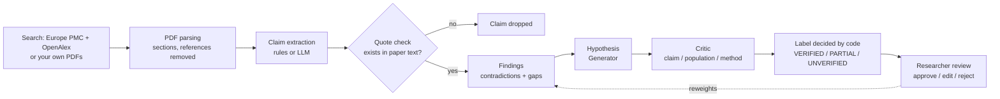

<div align="center">

# 🧭 PaperPilot

### An AI research co-pilot that **finds, reads and cross-checks scientific papers** and never invents a quote.

Built for **medical instrumentation and health research**: wearables, biosignals, imaging, rehabilitation engineering and diagnostics.

<p>
  
  
  
  
  
</p>

[Quick start](#-quick-start) · [Features](#-features) · [How it works](#-how-it-works) · [Trust model](#-trust-model) · [Project structure](#-project-structure) · [Roadmap](#-roadmap)

</div>

---

## ✨ Why PaperPilot?

Reading 30 papers to find where studies *disagree*, what nobody has tested yet, and which hypothesis is actually supported is slow, and general chatbots happily make up citations while doing it.

PaperPilot takes the opposite approach:

| Typical AI assistant | **PaperPilot** |
|---|---|
| Fluent answers, unverifiable sources | Every claim carries a **quote that code has checked** against the paper text |
| An LLM decides how "confident" it is | **Plain code** decides `VERIFIED` / `PARTIALLY VERIFIED` / `UNVERIFIED` |
| Needs an API key to do anything | **Offline mode** works with no key and gives the same answer every time |
| Black box | You **approve, edit or reject** every hypothesis, and your decisions re-rank what is shown next |

## 🚀 Features

| | |
|---|---|
| 💬 **Chat assistant** | Ask in plain words: *"Find recent open-access papers on wearable ECG for arrhythmia detection"*, *"analyse my papers"*, *"show contradictions"*, *"what are the research gaps?"*, *"which sensor was used in the stroke studies?"* |
| 🔎 **Paper discovery** | Live search over **Europe PMC** (incl. PubMed) and **OpenAlex** with domain presets, year / open-access / sort filters, duplicate merging and open-access PDF download. No keys needed |
| 📚 **Library** | Reference-manager style cards, saved between sessions, with duplicate detection and clear **full-text vs abstract-only** marking |
| 🧪 **Cross-paper analysis** | Structured claims, **contradictions** (with population / method / dataset differences as the explanation), **research gaps**, and **hypotheses** |
| ✅ **Hypothesis verification** | Generator → Critic pipeline with evidence retrieval; final label decided by code |
| 🔬 **Paper review** | Extractive summary, study design, sample size and a **reporting checklist** (control group, randomisation, blinding, ethics, statistics, metrics, limitations), each with its evidence sentence |
| 🕸️ **Knowledge graph** | Interactive graph of papers, interventions, outcomes and relations |
| 📈 **Quality & export** | Claim coverage, contradiction precision, gap recall and reviewer agreement against your own answer key; Markdown / JSON export |
| 📊 **Analytics panel** | Activity, topics in your library and insight quality. Real numbers only; empty states show `n/a` |

## ⚡ Quick start

**Requirements:** Python 3.10+ (developed and tested on 3.12). Internet is only needed for paper search.

```bash
git clone https://github.com/Chitira25/PaperPilot.git
cd PaperPilot

python -m venv venv
# Windows
venv\Scripts\activate
# macOS / Linux
source venv/bin/activate

pip install -r requirements.txt
python -m streamlit run app.py
```

Open **http://localhost:8501**. Streamlit may ask for an email on first run; just press Enter.

### Try it in 60 seconds (no API key, no downloads)

1. In the sidebar, click **🧪 Load rehab demo (synthetic)**: 5 fictional stroke / Parkinson's EMG grip-rehab papers with an answer key.
2. In the **Assistant** tab, type `analyse my papers`.
3. Open **Analysis** to see contradictions, gaps and hypotheses, each with a verification label and real quotes.
4. Approve, edit or reject a hypothesis and watch the ordering change.

### Use your own papers

Drop PDFs in `data/papers/`, named so the part before the first underscore is the paper id (`P1_Author_Title.pdf`), then click **Load my papers**. Optionally copy `data/ground_truth_template.json` to `data/papers/ground_truth.json` and fill it in to unlock the **Quality** metrics. PaperPilot only *reads* your PDFs; it never modifies or deletes them.

### Optional: Live LLM mode

Offline mode is the default. To get written answers, choose a provider in the sidebar and paste a key (kept only in the browser session).

| Provider | Notes |
|---|---|
| Gemini | default model `gemini-1.5-flash` |
| OpenAI | default model `gpt-4o-mini` |
| Groq | default model `llama-3.3-70b-versatile` |
| Ollama | local, no key needed |
| Custom | any OpenAI-compatible endpoint |

Even in Live mode, quotes in model output are verified by code and flagged if they do not appear in your papers, and an AI critic can **never raise** a verification label.

## 🧠 How it works



1. **Claims.** Structured as intervention, outcome, direction (`positive` / `none` / `negative` / `reported`), population, method and dataset, using a shared medical vocabulary you can extend.
2. **Quote check.** Every quote must exist in its paper, otherwise the claim is dropped.
3. **Findings.** Contradictions and gaps come from repeatable rules, not from model opinion.
4. **Hypotheses.** One per finding, written only from facts found in the papers.
5. **Verification.** The Critic answers three true/false questions; plain code turns them plus the quote check into the final label.
6. **Feedback loop.** Your approve / edit / reject decisions are stored and change finding weights.

## 🛡️ Trust model

* **Never invents** a paper, quote or number. Every search result links to its source.
* Verification labels are decided by **code, not by an AI model**.
* The paper appraisal is a **checklist of what the text reports**, not a quality score and not medical advice.
* Abstract-only papers are **clearly marked**; paywalled full text is never scraped.
* Deterministic offline engine: same input, same output.

## 🗂️ Project structure

```text
PaperPilot/
├── app.py                     Streamlit UI (chat, cards, analytics)
├── modules/
│   ├── agent.py               chat brain: intent routing, tools, grounded answers
│   ├── discovery.py           Europe PMC + OpenAlex search, merge, PDF download
│   ├── library.py             saved library + activity log
│   ├── pdf_processor.py       PDF text, sections, reference stripping
│   ├── extraction.py          rule-based claim extraction
│   ├── vocab.py               medical vocabulary (devices, signals, patients, outcomes)
│   ├── rules.py               contradiction and gap detection
│   ├── hypothesis.py          rule-based hypothesis generator
│   ├── verify.py              quote check, evidence retrieval, final label
│   ├── analyzer.py            pipeline orchestration
│   ├── appraisal.py           study design, sample size, reporting checklist, summary
│   ├── llm_engine.py          optional LLM providers (cache, retry, honest fallback)
│   ├── feedback.py            researcher decisions -> finding weights
│   ├── evaluate.py            coverage / precision / recall against an answer key
│   ├── analytics.py           numbers for the analytics panel
│   └── knowledge_graph.py     interactive graph
├── scripts/                   tests and demo-PDF generators
├── data/
│   ├── rehab_demo_papers/     5 synthetic papers + answer key
│   ├── sample_papers/         5 RAG-topic PDFs
│   ├── papers/                put your own PDFs here
│   └── vocab.example.json     extend the vocabulary
└── .streamlit/config.toml     theme
```

## ✅ Tests

```bash
python scripts/test_pipeline.py   # 38 pipeline correctness checks
python scripts/test_agent.py      # 48 agent / search / library / analytics checks
```

Network calls are tested with recorded responses and mocks, so the suite runs offline. CI runs both on every push.

## 🧩 Customising the vocabulary

Copy `data/vocab.example.json` to `data/vocab.json` and add your own devices, populations and outcomes. PaperPilot merges them with the built-in terms on the next run.

## ⚠️ Known limitations

* Contradiction rules compare terms found in the vocabulary; unknown terminology needs `data/vocab.json`.
* Direction comes from word cues, so check borderline sentences by eye.
* Abstract-only papers yield few claims; full text is much better.
* No OCR for scanned PDFs.
* The graph library loads from a CDN on first view.
* Search code is tested against recorded responses; if a source changes its format the app reports which one failed and keeps using the other.

## 🗺️ Roadmap

- [ ] OCR support for scanned PDFs
- [ ] Embedding-based retrieval alongside the current lexical retrieval
- [ ] Zotero / BibTeX import and export
- [ ] Shareable analysis reports (PDF)
- [ ] Dockerfile for one-command deployment

## 🤝 Contributing

Issues and pull requests are welcome. See [CONTRIBUTING.md](CONTRIBUTING.md) and the [CHANGELOG](CHANGELOG.md).

## 👥 Credits

Created by **Chitira B** with **Mythili Y** (Team Quorum), as a Human-AI collaboration for scientific discovery project.

## 📄 License

Released under the [MIT License](LICENSE).

> PaperPilot is a research aid. It does not provide medical advice, and every output should be checked against the cited source.
